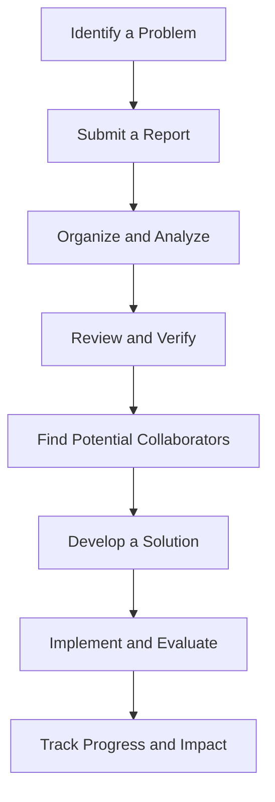
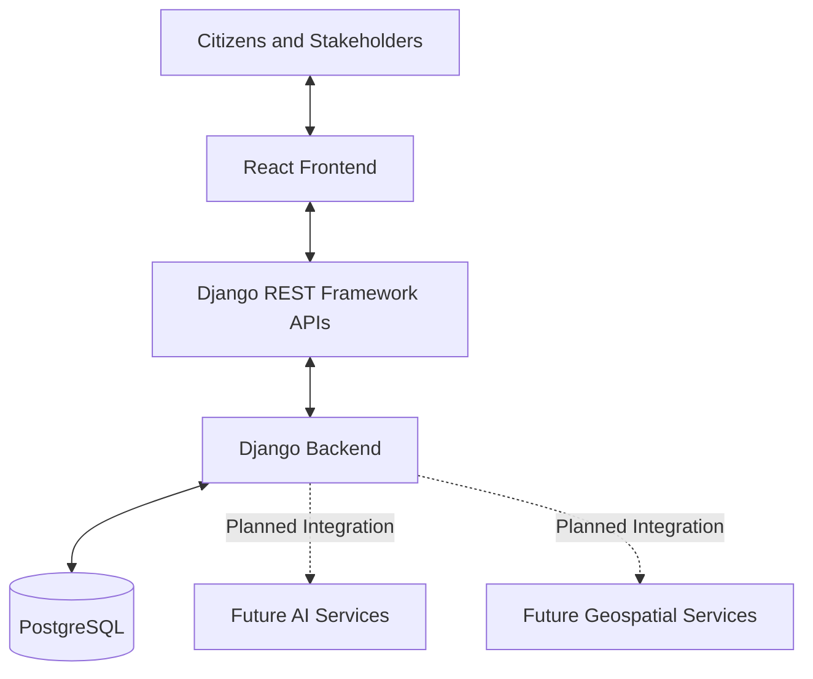

# ResolveNet — Connecting Challenges. Creating Solutions.

  <strong>An AI-enabled civic collaboration platform for turning real-world problems into practical solutions.</strong>

  Connecting citizens, government authorities, universities, researchers, and industry partners through a shared problem-solving platform.

  <em>Identify. Verify. Collaborate. Resolve.</em>

---

## Project Overview

ResolveNet aims to bridge the gap between identifying a civic problem and finding a practical solution.

From waste management and water wastage to damaged infrastructure, communities face challenges that often lack a clear path from reporting to resolution.

The platform brings citizens, authorities, and potential solution providers together through a structured workflow supported by AI-assisted analysis.

  
  

## The Problem

Community issues can remain unresolved when reporting, verification, and collaboration happen in disconnected systems.

- **Fragmented reporting:** Information about the same issue is scattered across different channels.
- **Duplicate reports:** Multiple submissions can describe the same problem.
- **Limited collaboration:** Communities may struggle to connect with relevant experts and organizations.
- **Difficult prioritization:** Important issues can get lost among numerous reports.
- **Limited visibility:** People may not know what happens after reporting a problem.

  

## Our Solution

ResolveNet is designed to connect the different stages of civic problem-solving.

| Capability | Purpose |
|---|---|
| Problem Reporting | Submit issues with descriptions, images, and location details. |
| AI-Assisted Analysis | Categorize reports, summarize information, and identify potential duplicates. |
| Verification | Help authorized reviewers assess reported issues. |
| Collaboration | Connect challenges with relevant students, researchers, and experts. |
| Solution Development | Support the development of practical solutions and projects. |
| Progress Tracking | Make project progress and milestones easier to follow. |

*AI-assisted analysis, advanced matching, and other planned capabilities are subject to implementation.*

## How ResolveNet Works

### Example Use Case

Consider a neighbourhood experiencing repeated water wastage.

1. A citizen reports the issue with a description and location.
2. The report is reviewed and verified.
3. Related reports can be grouped to identify the broader issue.
4. Authorities and technical experts can explore potential solutions.
5. Progress can be tracked as the solution moves toward implementation.

This illustrates the intended workflow; not every stage is currently automated.

## Technology Stack

| Technology | Purpose |
|---|---|
| React | Frontend and interactive user interface |
| Django | Backend logic and application services |
| Django REST Framework | API development and communication |
| PostgreSQL | Structured data storage |
| PostGIS — Planned | Geospatial queries and location-based analysis |
| AI Integration — Planned Capabilities | Classification, summarization, duplicate detection, and intelligent matching |

## System Architecture

The architecture separates the frontend, backend services, and database to support maintainability and future expansion.

## Project Screenshots

### Home Page

Introduces ResolveNet and its core purpose.

  

### Problem Reporting

Allows users to describe a complaint and attach an image.

  

### Dashboard and Community Feed

Displays complaint posts shared by other users.

  

### Authentication

Shows the authentication interface for accessing the platform.

  

## What Makes ResolveNet Different?

- **End-to-end approach:** Focuses on the journey from reporting to resolution.
- **Multi-stakeholder collaboration:** Brings communities and potential solution providers together.
- **AI-assisted organization:** Aims to make large volumes of reports easier to manage.
- **Knowledge-driven solutions:** Creates opportunities for academic and industry expertise to contribute.
- **Transparent progress:** Emphasizes visibility into project stages and outcomes.

## Development Roadmap

- [x] Define the project concept and architecture.
- [x] Develop the initial React frontend and begin backend development.
- [ ] Complete and test the end-to-end reporting workflow.
- [ ] Improve authentication and frontend-backend integration.
- [ ] Implement AI-assisted classification and summarization.
- [ ] Explore duplicate detection and collaborator matching.
- [ ] Add geospatial analysis and stakeholder dashboards.
- [ ] Introduce progress tracking and impact measurement.

*Update the checklist to reflect the actual implementation status.*

## Privacy and Source Code

The source code is maintained in a private repository.

This public repository serves as a project showcase, presenting ResolveNet's purpose, design, architecture, and development roadmap without exposing its private implementation.

Credentials, API keys, environment files, and confidential implementation details are not included.

## Future Vision

ResolveNet aims to make civic problem-solving more collaborative and transparent through:

- AI-assisted analysis and prioritization.
- Better connections between challenges and potential contributors.
- Collaboration with student teams and research institutions.
- Project milestones and progress updates.
- Impact measurement for implemented solutions.

Our goal is to help communities move beyond reporting problems toward developing and implementing practical solutions.

## About the Project

ResolveNet explores how modern web technologies and AI-assisted tools can connect people, knowledge, and resources to address real-world challenges.

**ResolveNet — Connecting Challenges. Creating Solutions.**
