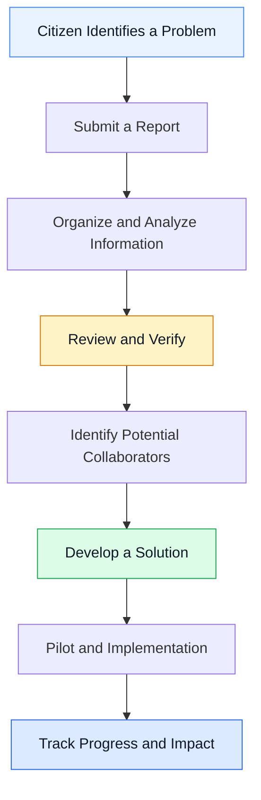
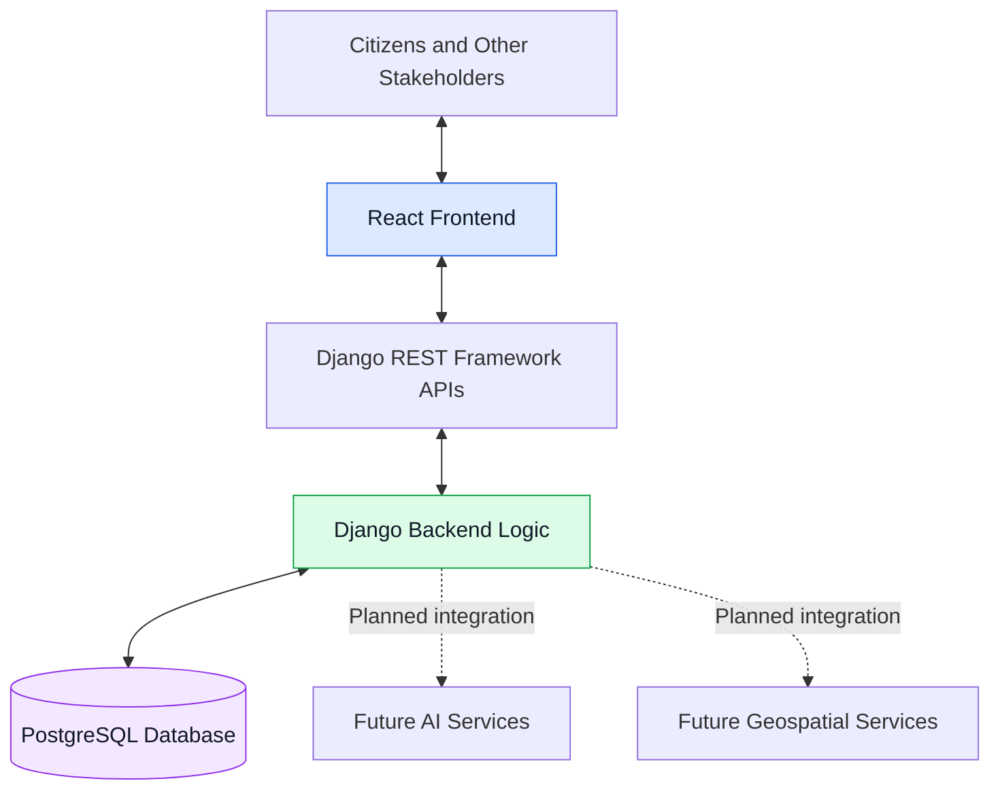

# ResolveNet — Connecting Challenges. Creating Solutions.

  <strong>An AI-enabled civic collaboration platform for turning real-world problems into collaborative solutions.</strong>

  Connecting citizens, government authorities, universities, researchers, and industry partners through one shared problem-solving ecosystem.

  <em>Identify. Verify. Collaborate. Resolve.</em>

---

## Project Overview

ResolveNet is a civic problem-solving platform built around a simple idea: **identifying a problem should be the beginning of solving it, not the end.**

Communities face challenges such as waste management, water wastage, damaged infrastructure, and other public-service issues. Although people can raise concerns, connecting those problems with the right expertise, resources, and organizations can be difficult.

ResolveNet aims to bridge this gap by creating a structured environment where problems can be reported, reviewed, and connected with people who can help develop practical solutions.

The platform brings together technology, collaboration, and AI-assisted analysis to make civic problem-solving more organized, accessible, and transparent.

<!-- Add your project banner at docs/assets/resolvenet-banner.png -->

  
  
  
  

## The Problem We're Solving

Many community problems are not caused by a lack of awareness. They remain unresolved because the process of addressing them can be fragmented.

- **Disconnected reporting:** Information about the same problem can be scattered across different channels.
- **Duplicate submissions:** Multiple people may report the same issue without their reports being connected.
- **Limited collaboration:** Communities may lack a straightforward way to connect with researchers, technical experts, or potential solution providers.
- **Difficult prioritization:** Important challenges can be difficult to identify among large volumes of reports.
- **Limited visibility:** People may not know what happens after an issue is reported.

ResolveNet is designed to bring these activities into one connected workflow.

## Our Solution

ResolveNet focuses on the complete journey of a civic challenge, from the initial report to potential implementation and measurable impact.

| Capability | Purpose |
|---|---|
| Problem reporting | Collect descriptions, supporting images, and location details. |
| AI-assisted analysis | Help categorize reports, summarize information, and identify potential duplicates. |
| Verification | Support the review of reported problems by authorized people. |
| Collaboration | Connect suitable challenges with students, researchers, universities, and industry experts. |
| Solution development | Support the progression from a verified challenge to a proposed solution or project. |
| Progress tracking | Make project stages and progress easier to understand. |

*Note: These capabilities describe the platform's intended direction. AI-driven analysis, advanced matching, and other planned modules should be presented as upcoming features until they are implemented.*

## How ResolveNet Works

The following diagram illustrates the intended workflow of the platform.

### Example Use Case

Imagine a neighbourhood experiencing repeated water wastage.

1. A citizen reports the issue with a description and location.
2. The report is organized and reviewed to determine whether further verification is required.
3. Related reports can be identified and considered together.
4. Relevant authorities can assess the problem, while technical experts or university teams may contribute possible solutions.
5. If a solution is approved and implemented, its progress and outcomes can be tracked.

This is an example of how ResolveNet could support collaborative problem-solving, rather than a claim that every stage is already automated.

## Technology Stack

ResolveNet is being developed using technologies that support a modern web application and provide room for future expansion.

| Technology | Role |
|---|---|
| React | Component-based frontend and interactive user interface |
| Django | Backend application logic and server-side functionality |
| Django REST Framework | API development and communication between application components |
| PostgreSQL | Structured data storage |
| PostGIS — planned | Geospatial queries and location-based analysis |
| AI integration — planned capabilities | Report summarization, classification, duplicate detection, and intelligent matching |

The stack is intended to provide a maintainable foundation for connecting the user interface, backend services, and future intelligent features.

## System Architecture

ResolveNet follows a modular architecture in which the frontend communicates with backend APIs, the backend manages application workflows, and the database stores structured information.

The architecture is intended to support clear separation between the interface, business logic, data storage, and future analytical services.

## Project Screenshots

Visual previews help visitors understand the project without needing access to its source code.

Add screenshots captured from your actual application to the `docs/assets/` folder, then update the paths below.

<!-- Uncomment these image sections after adding the corresponding screenshot files. -->

<!--
### Home Page

### Problem Reporting

### Dashboard

### Authentication

-->

Recommended screenshots:

- **Home page:** Introduce ResolveNet and its purpose.
- **Problem reporting:** Show how a user can describe a challenge.
- **Dashboard:** Display the available interface and project information.
- **Authentication:** Show the login or registration experience.

Use real screenshots of working features. Avoid showing private information, API keys, tokens, or personal user data.

## What Makes ResolveNet Different?

ResolveNet is designed around collaboration, not just complaint collection.

- **A complete problem-solving lifecycle:** The concept extends beyond reporting to verification, collaboration, and implementation.
- **Multiple stakeholders:** It brings citizens, authorities, academic institutions, and industry participants into one proposed ecosystem.
- **AI-assisted organization:** Planned AI capabilities could help people process reports more efficiently.
- **Knowledge-driven solutions:** Universities, researchers, and industry experts could contribute expertise to challenges that need more than a conventional complaint workflow.
- **Transparency and accountability:** Progress tracking is intended to make the status of a challenge easier to understand.

## Development Roadmap

Our development priorities are organized around building a reliable foundation before expanding the platform's capabilities.

- [x] Establish the project concept and core architecture.
- [x] Develop the initial React frontend and begin backend development.
- [ ] Complete and test the end-to-end reporting workflow.
- [ ] Strengthen authentication and frontend-backend integration.
- [ ] Introduce AI-assisted report classification and summarization.
- [ ] Explore duplicate detection and intelligent collaborator matching.
- [ ] Add location-based analysis and stakeholder-specific dashboards.
- [ ] Develop project progress tracking and impact measurement.

*The checklist should reflect the actual state of the private repository. Update it as features are completed and tested.*

## Privacy and Source Code

ResolveNet's source code is maintained in a private repository.

This public repository serves as a **project showcase**, providing an overview of the project's purpose, architecture, technology stack, and development direction without publishing the private implementation.

The showcase may include selected screenshots, diagrams, and documentation to help visitors understand the project.

Source code, environment files, credentials, API keys, and other confidential implementation details are intentionally excluded.

## Future Vision

We envision ResolveNet becoming a platform where meaningful community challenges can find the right expertise, resources, and collaborators.

Future development may explore:

- AI-assisted analysis and prioritization.
- Better connections between verified challenges and potential contributors.
- Collaboration opportunities for student teams and research institutions.
- Transparent project milestones and progress updates.
- Impact measurement to evaluate the outcomes of implemented solutions.

Our long-term goal is to make collaboration around societal problems easier to organize and more focused on practical outcomes.

## About the Project

ResolveNet is a project built around the belief that solving real-world problems requires more than identifying what is wrong. It requires connecting people, sharing knowledge, and creating opportunities for meaningful action.

We are exploring how modern web technologies and AI-assisted tools can help make that process more effective.

**ResolveNet — Connecting Challenges. Creating Solutions.**

